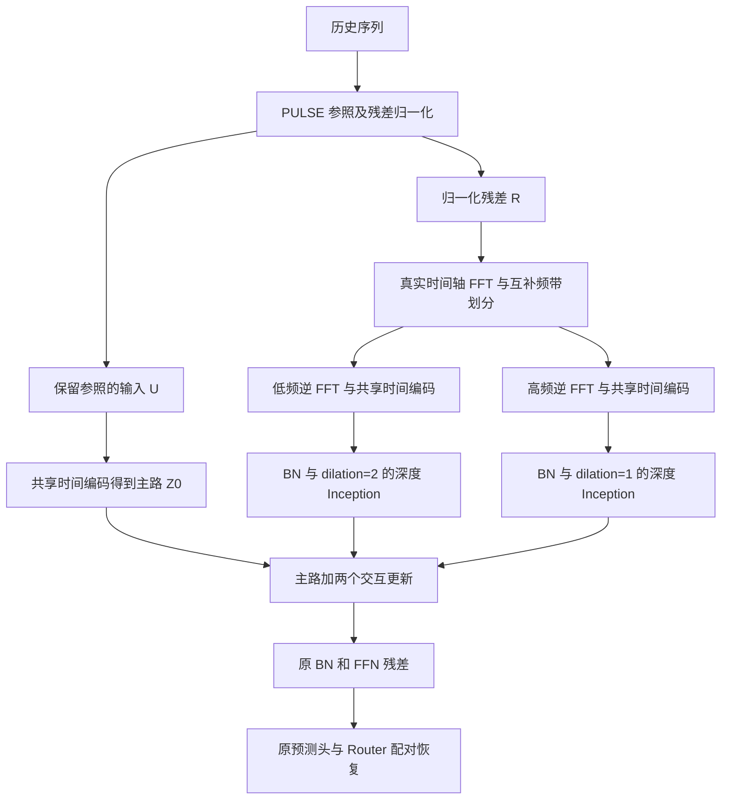

# PULSE_FACT_BDI：频带解耦变量交互开发计划与记录

日期：2026-11-12。代码起点：`f2bff2f0b5872dfd4370eb3e7d749b148bbdc539`。遵守 [AGENTS.md](../../AGENTS.md)，沿用 [主模型开发记录](PULSE-FACT开发计划与记录.md) 的独立文件、显式数据流和简约脚本规范。

## 1. 目标、来源与范围

BDI（Band-Decoupled Interaction，频带解耦交互）是待验证的新候选：让不同历史时间频带承担不同范围的变量交互，主路保留 PULSE 的参照与配对恢复。研究目标是检验这一分工，允许其不在每项任务上超过旧 PF；仍保留旧 PF、PULSE 和完整 FACT 的统一协议对照，不能将来源模型比较代替新机制消融。

完整 FACT 的双域框架没有直接复制到 PF。PF 以 PULSE 为主框架，仅复用 FACT 的 DConvBlock。BDI 进一步改变两个卷积分支的输入来源，不改写来源算子，不新增 MP 均值约束、动态门控、层数或损失。

本次仅开发 `PULSE_FACT_BDI`。不开发双域并行备选，不开展大桥任务，不改变历史模型、层、脚本、数据处理与输出。

工作区起点已有多处用户修改、日志删除及未跟踪笔记。开始时已记录完整 Git 状态、现有修改文件哈希和保护文件哈希；本次按路径提交 BDI 增量，不合并无关改动。来源文件及哈希将写入 `notes/data/pulse_fact_bdi_sources.json`。

## 2. 架构与张量接口

输入：`X [B,L,C]`、`cycle_index [B]`、历史时间标记 `[B,L,time_dim]`、未来时间标记 `[B,H,time_dim]`。训练返回 `(prediction, mixup_params)`，推理返回 `prediction [B,H,C]`，与既有实验类兼容。



设学习参照为 A，使用与 PF 相同的残差归一化，显式保留中间残差：

$$
R=\operatorname{ReVIN}(X-A),\quad U=R+A.
$$

SAM 使用同一个 lambda、排列混合 U、R 和统计量；R 在混合之后分频。Router 和未来标记继续采用原 PF 协议，不额外混合参照或改变监督目标。

$$
F=\operatorname{rFFT}_t(R_{\mathrm{mixed}}),\quad
R_l=\operatorname{irFFT}(M_lF),\quad
R_h=\operatorname{irFFT}((1-M_l)F).
$$

FFT 沿真实历史时间轴 L 执行，`norm='ortho'`；逆变换显式指定 `n=L`，支持奇数历史长度。默认低频截止为 Nyquist 的 0.25：第 k 个 rFFT 频点满足 `2*k/L <= 0.25` 时归入低频，其余归入高频；DC 属于低频。L=96 时低频为 k=0…12，高频为 k=13…48。

使用同一个 Linear(L,512) 和 GELU 编码三条路径；非线性编码后不要求三个表示具有加法分解恒等式。

$$
Z_0=\phi(W_1U^\top),\quad Z_l=\phi(W_1R_l^\top),\quad
Z_h=\phi(W_1R_h^\top).
$$

三者均为 `[B,C,512]`，转换为 `[B,512,G,G]` 的变量网格后：

$$
S=Z_0+\mathcal D_1(\operatorname{BN}_1(Z_h))
       +\mathcal D_2(\operatorname{BN}_2(Z_l)),\quad
Z_{out}=S+\operatorname{FFN}(\operatorname{BN}(S)).
$$

上式省略网格变换。D1／D2 仅是交互更新，不包含额外主残差。沿用 FACT 两组独立 BN、深度 Inception 与 FFN；低频用 dilation=2，高频用 dilation=1。网格沿用确定性的循环补齐和裁剪，不使用 scatter 或 index_select。

最后共享原 Linear(512,H)，只调用一次 Router／恢复。BDI 与 PF 在相同配置下参数量相同，计算量增加；不预设精度、效率或物理一致性改善。

## 3. 相对 PF 的变化与创新边界

| 环节 | PF | BDI |
| --- | --- | --- |
| 参照、归一化、SAM、恢复 | 原 PULSE 协议 | 保留，并显式输出归一化残差用于分频 |
| 两个卷积分支输入 | 同一份含参照的隐藏表示 | 分别来自高频／低频历史残差 |
| 主残差 | 原隐藏表示 | 仍为含参照的主路 Z0 |
| 编码器 | 一次时间编码 | 三次调用同一组参数 |
| 块与损失 | 单块、原 FFT 损失 | 不增加块或新损失 |

研究问题：不同时间频带是否需要不同变量交互范围？“低频较大范围、高频较小范围”只是初始假设，需要交换分配和不分频对照。这里是频带分解后的时间域交互，不是 FACT 幅值／相角双路径，也不是已验证的物理传播。

变量网格仍是计算布局，不是真实路网。五分钟采样且 L=96 只有八小时，不把该窗口低频直接命名为日／周周期。相关命名和文献新颖性仍需后续核验。

## 4. 拟交付文件与接入

| 类型 | 路径 | 职责 |
| --- | --- | --- |
| 新增 | `models/PULSE_FACT_BDI.py` | 完整展开 Model、ReVIN、归一化、SAM、分频路由和恢复 |
| 新增 | `layers/pulse_fact_bdi/frequency.py` | 历史残差互补分频，无可学习参数 |
| 新增 | `layers/pulse_fact_bdi/interaction.py` | 复用来源子模块，显式实现两种输入和单次残差／FFN |
| 新增 | `layers/pulse_fact_bdi/__init__.py` | 命名空间 |
| 最小修改 | `exp/exp_main.py` | 只增加一行导入和一项模型注册 |
| 新增 | `tests/test_pulse_fact_bdi.py` | 分频、梯度、SAM、兼容、保存恢复和脚本检查 |
| 新增 | `notes/data/pulse_fact_bdi_sources.json` | 来源、哈希、差异与脚本来源 |

`run.py` 保持原样，无新增 CLI 参数，无替代训练入口。模型专属可选 Python 配置使用 `pulse_fact_bdi_*` 前缀；默认脚本无需新增入口支持。若将来需要从 CLI 调参，再单独取得入口修改确认。

默认生效值：隐藏宽度 512、FFN 256、两组膨胀率 1／2、两种核 1／3、dropout=0.1、低频相对 Nyquist 截止 0.25、深度 1。配置写入日志和 checkpoint extra_state，加载不匹配配置时报错。

## 5. 首轮实验与脚本计划

选择 PEMS03、PEMS04 检验交通效果，ETTh1 作为已知退化边界。全部沿用对应 PF 脚本的配置，L=96，seed=2024、itr=1、30 轮、patience=5，不变更学习率、预算或数据协议。

| 新脚本 | 参考脚本 | H | 预计日志 |
| --- | --- | --- | --- |
| `scripts/PULSE_FACT_BDI/PEMS03.sh` | `scripts/PULSE_FACT/PEMS03.sh` | 12、24、48、96 | `logs/PULSE_FACT_BDI/PEMS03/PULSE_FACT_BDI_96_<H>.log` |
| `scripts/PULSE_FACT_BDI/PEMS04.sh` | `scripts/PULSE_FACT/PEMS04.sh` | 12、24、48、96 | `logs/PULSE_FACT_BDI/PEMS04/PULSE_FACT_BDI_96_<H>.log` |
| `scripts/PULSE_FACT_BDI/ETTh1.sh` | `scripts/PULSE_FACT/ETTh1.sh` | 96、192、336、720 | `logs/PULSE_FACT_BDI/ETTh1/PULSE_FACT_BDI_96_<H>.log` |

每份脚本保持顶部变量、四段直接命令、`set -e`、标准输出与错误重定向，不新增函数。checkpoint 为 `checkpoints/PULSE_FACT_BDI/<setting>/checkpoint.pth`。固定日志名重复运行会覆盖，应由运行者先归档。这里只新增三份基础脚本，不擅自扩大到全数据集或新增批量清单。

从工程根目录按优先级手动顺序运行：

```bash
bash scripts/PULSE_FACT_BDI/PEMS04.sh
bash scripts/PULSE_FACT_BDI/PEMS03.sh
bash scripts/PULSE_FACT_BDI/ETTh1.sh
```

## 6. 检查与后续消融

开发检查：频带重建与频点归属、奇偶长度、可微性、匹配输入时与 PF 块一致、参数量／初始化一致、SAM 一次采样和混合对应、FFT 损失下严格确定性反向与更新、保存恢复与配置保护、Exp_Main 接入、十二组脚本实际参数／前向／日志及失败传递。执行与改动相关的旧 PF 回归。

正式实验之后再安排：交换低高频的交互范围；关闭分频并使用匹配残差输入；旧 PF 对照；统一协议的 PULSE／完整 FACT；代表任务多种子。第一轮不实现这些额外模型或以测试集选择截止频率。

## 7. 实施状态与实验记录

- 已按计划完成独立模型、分频与交互模块、三份四时距脚本和最小导入／注册。原模型、原层、原脚本与 run.py 的哈希核对一致；开始时已有的修改和删除保持原样。
- 正式十二组训练均待运行，不填推测指标。本轮完成的是随机输入检查，不是数据集精度实验。
- 本机无 CUDA，GPU 确定性检查仍待服务器执行。

| 数据集 | H | PULSE | 完整 FACT | PF | BDI | 分析 |
| --- | --- | --- | --- | --- | --- | --- |
| PEMS03 | 12／24／48／96 | 见原结果 | 待统一协议 | 见原结果 | 待运行 | 待填写 |
| PEMS04 | 12／24／48／96 | 见原结果 | 待统一协议 | 见原结果 | 待运行 | 待填写 |
| ETTh1 | 96／192／336／720 | 见原结果 | 待统一协议 | 见原结果 | 待运行 | 待填写 |

### 7.1 已执行检查

| 环境／范围 | 结果 |
| --- | --- |
| Python 3.8.20／PyTorch 2.0.0 CPU，BDI 专项 | 15 项中 14 项通过，1 项 CUDA 检查跳过 |
| Python 3.13.5／PyTorch 2.9.0 CPU，BDI 专项 | 同样 14 项通过、1 项跳过 |
| Python 3.8.20／PyTorch 2.0.0 CPU，原 PF 回归 | 15 项中 14 项通过，1 项 CUDA 检查跳过 |
| 三份脚本 | shell 语法、12 组实际调用参数和模型前向、固定日志、checkpoint 标识、失败即停均通过 |
| 工作区保护 | 起点已有的 46 条修改／未跟踪状态及保护文件核对无漂移；exp_main.py 仅新增两行接入 |

分频检查包含已知低／高频正弦和 DC、奇偶 L、梯度数值检查；交互检查包含 C=1／2／4／7／9／307／358／883 的网格、分支输入、单主残差，以及三输入相同情况下与 PF 的输出、梯度和 BN 统计一致性。

模型检查包含与 PF 相同的参数量及初始参数、SAM 同配对、一次恢复、原 FFT 损失下严格确定性的两次 Adam 更新、所有参数有限梯度、推理重复性、保存恢复及配置保护。全模型参数没有新增，但算量增加；本轮未测量正式显存、吞吐或训练时间。

可复现检查命令（先激活完整项目环境）：

```bash
python -B -m unittest discover -s tests -p test_pulse_fact_bdi.py -v
python -B -m unittest discover -s tests -p test_pulse_fact.py -v
```

另尝试过本机 tslib 环境（Python 3.9／torch 2.8），该环境缺少原项目所需 pandas，实验类导入未完成；随后改用已有完整环境通过检查，没有安装或调整依赖。不将缺依赖环境列为完整接入通过。

### 7.2 交付与后续记录

- 主模型：[PULSE_FACT_BDI.py](../models/PULSE_FACT_BDI.py)。
- 分频：[frequency.py](../layers/pulse_fact_bdi/frequency.py)；交互：[interaction.py](../layers/pulse_fact_bdi/interaction.py)。
- 来源、原始文件哈希、Git 版本及差异：[pulse_fact_bdi_sources.json](data/pulse_fact_bdi_sources.json)。FACT 原始实现及许可证继续保存在原 vendor 命名空间，运行和检查不要求存在兄弟 ZIP 目录。
- 脚本：[PEMS04.sh](../scripts/PULSE_FACT_BDI/PEMS04.sh)、[PEMS03.sh](../scripts/PULSE_FACT_BDI/PEMS03.sh)、[ETTh1.sh](../scripts/PULSE_FACT_BDI/ETTh1.sh)。
- 检查：[test_pulse_fact_bdi.py](../tests/test_pulse_fact_bdi.py)。

预计输出示例：

```text
PULSE-phy/
├── logs/PULSE_FACT_BDI/
│   ├── PEMS04/PULSE_FACT_BDI_96_{12,24,48,96}.log
│   ├── PEMS03/PULSE_FACT_BDI_96_{12,24,48,96}.log
│   └── ETTh1/PULSE_FACT_BDI_96_{96,192,336,720}.log
└── checkpoints/PULSE_FACT_BDI/
    └── <setting>/checkpoint.pth
```

花括号是文件名范围示意，实际每个 H 对应一个独立日志。原实验类独立 is_training=0 的旧路径限制仍存在，本次脚本使用 is_training=1 的训练后自动测试，不改写旧加载分支。
