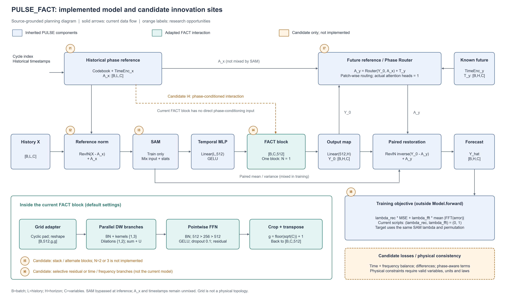

# PULSE、FACT 与 PULSE_FACT：论文创新与调参

创建／更新：2026-11-04。用途：从当前本地代码出发，核对三种模型的模块、参数与损失，定位可以尝试的自主机制，持续记录调参与消融。当前新增内容为分析、图示与检查记录，不改变模型和训练流程，也未启动正式训练。

遵守 [AGENTS.md](../../AGENTS.md)。论文主线、实验结论和题目讨论见 [论文编写与研究思路](PULSE_FACT论文编写与研究思路.md)。本文件以本地实现为准，**完整 FACT、FACT 来源交互块和当前 PULSE_FACT 分别讨论**；候选不预设提升，实施状态以以下更新和对应开发记录为准，创新性仍需查新与实验验证。

**2026-11-04 实施更新**：已新增 PCSM（相位条件化尺度混合）首版 `PULSE_FACT_PC` 和全局权重对照 `PULSE_FACT_STATIC`，完成 CPU 检查，正式训练与贡献验证待进行。具体差异、默认参数、六份单时距脚本及验收结果见 [开发计划与记录](PULSE_FACT_PC开发计划与记录.md)。下文保留原始三模型分析和候选讨论；原 PULSE_FACT 及图中的实线路径没有改变，多层、时滞和新损失仍未实现。

## 1. 源码范围、记号与核对结果

| 对象 | 本地依据 | 本次关注 |
| --- | --- | --- |
| 原版 PULSE | [模型](../models/PULSE.py)、[入口](../run.py)、[实验类](../exp/exp_main.py) | 相位参照、ReVIN、时间 MLP、SAM、Router、恢复及损失 |
| 完整 FACT | [模型](../../FACT-main/models/FACT.py)、[入口](../../FACT-main/run.py)、[脚本](../../FACT-main/FACT.sh)、[实验类](../../FACT-main/exp/exp_long_term_forecasting.py) | 时／频分支、Inception、膨胀深度卷积、FFN、归一化及损失；参考目录只读 |
| 当前 PULSE_FACT | [主模型](../models/PULSE_FACT.py)、[适配器](../layers/pulse_fact/fact_block.py)、[来源卷积](../layers/pulse_fact/vendor/fact_conv.py)、[来源记录](../layers/pulse_fact/vendor/sources.json) | 原 PULSE MLP 隐藏层插入单个 FACT 块 |
| 运行配置 | [PULSE 脚本](../scripts/PULSE/)、[PULSE_FACT 脚本](../scripts/PULSE_FACT/) | 12 数据集、各 4 个预测长度，共 48 组对应配置；不包含大桥内容 |
| 可复核快照 | [参数与配置 JSON](data/pulse_fact_parameter_audit.json)、[核对脚本](tools/audit_pulse_fact_parameters.py) | 源码 SHA256、入口默认值、48 组有效配置、逐组件参数量和最小检查结果 |

记号：`B` 为 batch，`L` 为历史长度，`H` 为预测长度，`C` 为变量数；`D=512` 为当前 PULSE／PULSE_FACT 时间 MLP 隐藏维度，`d` 为 PULSE Router 的 `d_model`，`P=inv_len`，`p=patch_size`。完整 FACT 的 `d_model` 另记为 `D_FACT`，不能与 Router 的 `d` 混为一谈。

本次审阅 HEAD：`c6cfcf625e1280144e3af41f090c8980099aabed`，具体源文件哈希见 JSON。该 HEAD 是分析起点，不代表已逐条认证历史训练的代码版本。

## 2. 三种模型的公共能力与实际复用关系

“公共模块”需要区分：**功能类似、源码直接继承、仅算子来源相同**。三者并不是使用同一整套模块。

| 功能／模块 | PULSE | 完整 FACT | 当前 PULSE_FACT | 关系判断 |
| --- | --- | --- | --- | --- |
| 时间维映射／预测头 | `Linear(L,512)→GELU→Linear(512,H)` | `Conv1d(L,D_FACT,1)` 与 `Conv1d(D_FACT,H,1)` | 保留 PULSE 两次线性映射，中间插入 FACT | 都进行时间维映射，具体主干不同 |
| 输入归一化与输出恢复 | 对 `X−A_x` 做带可学习仿射的 ReVIN，最后配对恢复 | 可选逐实例均值／方差归一化，对含可选时间 token 的输入整体处理 | 原 PULSE 归一化与恢复 | 能力类似，但 FACT 的归一化不是 PULSE 的 ReVIN |
| GELU／前馈映射 | 时间 MLP、时间编码与 Router 投影 | 卷积 FFN 的点卷积映射 | 保留 PULSE 部分，另有 FACT FFN | 都有非线性映射，不代表同一模块或参数 |
| 时间信息 | codebook 周期索引，历史／未来时间编码 | `freq=h/t/d` 时可把时间标记拼成额外变量 token | 保留 PULSE 时间编码；FACT 适配器用 `freq='n'`，不再追加 token | 接入位置及信息形态不同 |
| 相位 codebook／参照分解 | 有，`A_x=codebook[φ]+T_x` | 没有 PULSE 型参照 | 完整保留 | PULSE 与融合模型直接对应 |
| Phase Router | 有，基于 `A_x` 和中间预测生成未来参照 | 无 | 完整保留 | PULSE 与融合模型直接对应 |
| SAM | 训练时混合输入、均值、标准差，目标使用相同混合系数和置换 | 此源码训练流程无 PULSE SAM | 完整保留 | PULSE 与融合模型直接对应 |
| `Inception2d` | 无 | 多核深度卷积 | 使用保留来源记录的同源算子 | FACT 与融合模型共用的来源组件 |
| `Conv_block2d` | 无 | 按时域、幅值、相角路径多次调用 | 通过适配器调用一次，输入 `[B,C,512]` | 来源块相同，外部网络不同 |
| BN＋点卷积 FFN＋内部残差 | 无该变量交互块 | 各 `Conv_block2d` 内部包含 | 单个来源块内保留 | 不应在外部无说明地再次叠加同一残差 |
| 频域建模分支 | 模型前向中没有 FACT 型 FFT 分支 | 对嵌入特征沿隐藏轴 rFFT，再处理幅值／相角 | 当前没有完整 FACT 的时／频双分支 | 不能因为训练使用 FFT 损失就声称已有频域分支 |
| 训练目标 | 非 AMP 路径：时域 MSE 与复数 FFT 误差的加权和 | 本地长预测实验类使用 MSE | 沿用 PULSE 目标 | 损失属于实验类，不能只看模型文件或 `--loss` 字段 |

两种“phase”也不同：PULSE 指学习参照／周期索引；完整 FACT 的 `angle(rFFT(...))` 是嵌入特征的傅里叶相角。二者不是自动相同的物理相位。

## 3. 按源码还原数据流

### 3.1 PULSE

```text
X [B,L,C]、cycle_index、历史／未来时间标记
  → 时间编码 T_x、T_y 与 codebook
  → A_x；R_x = X−A_x
  → ReVIN(R_x) + A_x = X_in
  → 训练时 SAM 混合 X_in、mean、sigma；推理时跳过
  → 转置 [B,C,L] → Linear(L,512) → GELU → Linear(512,H)
  → Y_0 [B,H,C]
  → A_y = PhaseRouter(Y_0,A_x)+T_y
  → ReVIN.reverse(Y_0−A_y; mean,var)+A_y
  → 预测 [B,H,C]
```

训练返回 `(prediction, mixup_params)`，推理只返回预测。SAM 使用 `Beta(0.15,0.15)`；历史锚点和时间标记没有随输入一起混合。当前实现照实保留这一协议，不能在论文中写成所有条件同步混合。

### 3.2 完整 FACT

```text
X [B,L,C] → 可选拼接历史时间 token → 可选实例归一化
  → Conv1d(L,D_FACT,1)，得到 [B,D_FACT,C']
  ├─ 时域路径：串联若干 Conv_block2d
  └─ 频域路径：rFFT(dim=1) → 幅值／相角各自串联 Conv_block2d
                → 幅角重构 → irFFT
  → core * 时域 + (1−core) * 频域
  → Conv1d(D_FACT,H,1) → 可选统计量恢复 → 裁剪真实 C 个变量
```

这里的频域变换轴是投影后的隐藏轴；不能直接给它标注真实 Hz。`C'` 是否增加时间 token 取决于 `freq`。一组 `dilation=[1,2,3,2,1]` 表示外层 5 个块，第 i 块内部又含 dilation 为 `1..dilation[i]` 的并行分支。

**本地源码问题，未修复**：`forecast()` 的第二个条件重复写成 `elif self.alpha == 1.0`，而不是对应构造器的 `core=0` 路径。CPU 检查确认 `core=0` 会落入引用 `conv_time` 的分支并报 `AttributeError`；不能把 `core=0` 当作当前已可用的纯频域实验。来源脚本包含这一取值，复现前需单独适配和验证，不能静默改动只读源码。

### 3.3 当前 PULSE_FACT：实际融合位置

```text
原 PULSE 参照、归一化与 SAM
  → Linear(L,512) → GELU，Z [B,C,512]
  → PULSEFACTBlock(Z)，形状不变
  → Linear(512,H)
  → 原 PULSE Router 与配对恢复
```

令 `U` 是转置、周期补齐和网格化后的 `[B,512,g,g]` 特征，`g=floor(sqrt(C))+1`。当前块的两个内部阶段为：

$$
V=U+f_{d=1}(U)+f_{d=2}(U),\qquad W=V+\operatorname{FFN}(V).
$$

`f_d` 为 BN 后的多核深度卷积，默认核集合为 `{1,3}`。这是**两个并行膨胀分支，随后一个 FFN**，不是两个外层串联块。裁剪补齐部分并转置后恢复 `[B,C,512]`。

FACT 接收保留相位参照的归一化表示经 MLP 得到的隐藏特征，当前没有“纯残差交互分支”、独立门控、独立幅值／相角路径或额外外层堆叠。

## 4. 参数对比表：含义、默认值与实际生效位置

### 4.1 主干、归一化与输入接口

下表的“默认”是各仓库入口默认，不代表已经运行的脚本配置。`—` 表示无此对应项。

| 项目 | PULSE | 完整 FACT | PULSE_FACT | 重要区别 |
| --- | --- | --- | --- | --- |
| `seq_len / pred_len` | 默认 96／96 | 默认 96／96 | 沿用 PULSE | 当前融合脚本 L=96；长预测 H=96/192/336/720，PEMS H=12/24/48/96 |
| `enc_in / c_out` | 模型输出实际为 `enc_in` 个变量 | 裁剪输出到 `enc_in` | 同 PULSE | 不通过修改 `c_out` 单独改变融合模型通道数 |
| `d_model` | 默认 512，但只控制 Router 的 `d` | 默认 512，控制主干 `D_FACT` | 同 PULSE，脚本实际为 16 或 32 | **融合模型改 `d_model` 不会改变时间 MLP 的 512** |
| 时间 MLP 隐藏宽度 | 固定 512 | 由 `d_model` 控制投影宽度；没有同样的两层 GELU MLP | 固定 512，FACT 的隐藏宽度也固定为 512 | 改宽度属于新结构实现，不能只改旧参数 |
| `d_ff` | 入口默认 2048，当前 PULSE 主模型不读取 | 默认 1024，用于来源卷积 FFN；脚本有覆盖 | 旧 `d_ff` 不控制 FACT；专属字段默认 256 | 三者不能按同名字段直接对齐 |
| 输入归一化 | 无条件调用带仿射 ReVIN | `use_norm=1` 默认，可由脚本关闭 | 同 PULSE | 融合模型的 `use_revin/revin` 旧入口开关未接入实际分支 |
| 方差与 epsilon | `torch.var` 默认样本方差；epsilon=1e−5 | `unbiased=False`；epsilon=1e−5，均值 detach | 同 PULSE | 两种归一化计算不完全一致 |
| 仿射参数 | ReVIN 有 `weight/bias`，共 2C | 此实例归一化无同样可学习仿射 | 同 PULSE | 不应仅标成统一的 RevIN |
| 时间 token | 分别用历史／未来时间编码，不追加到 FACT 网格 | `freq=t/h/d` 追加 5/4/3 个 token，其他值不追加 | 适配器固定 `freq='n'`，只处理真实变量 | 这里的固定 n 不改变外部 PULSE 时间编码 |

### 4.2 PULSE 与融合模型共有的参数

| 参数／结构 | PULSE | PULSE_FACT | 当前实际含义与限制 |
| --- | --- | --- | --- |
| `inv_len=P` | 入口默认 24 | 相同 | codebook 形状 `[P,C]`；48 脚本配置实际包含 12/24/32/48/72/96，不自动等同真实日／周周期 |
| `time_dim` | 默认 4 | 相同 | 时间标记末轴大小；脚本实际为 1 或 2，需要与 loader 对齐 |
| `dsa / dsb` | 默认 8／1 | 相同 | 时间编码投影宽度 `a=C//dsa, b=C//dsb`，两者都必须 ≥1 |
| `ksize` | 默认 11 | 相同 | 时间编码中的 Conv1d 核；脚本主要为 3/5，另有 11 |
| `patch_size=p` | 默认 24 | 相同 | Router patch 大小；需要同时整除 L、H，不是旧 `patch_len` |
| Router heads | 两个 AttentionLayer 均固定 1 | 相同 | 旧 `n_heads=8` 不会变成实际 8 头 |
| Router attention dropout | 固定 0.1 | 相同 | 不受旧 `dropout=0` 关闭 |
| Router factor | 固定传入 5 | 相同 | FullAttention 路径未以此建立 ProbSparse 采样；不据它宣称稀疏复杂度 |
| SAM Beta 参数 | 固定 0.15／0.15 | 相同 | 不是入口参数；修改需新命名实现或经确认接入专属参数 |
| SAM 开关 | forward 的 `do_mixup=True`，且仅训练开启 | 相同 | 当前训练脚本没有对应 CLI 开关 |
| `e_layers / d_layers` | 当前主模型不据此构造层数 | 相同 | 改为 3 不会产生三层融合块 |

**时间编码的轴要读准确**：输入为 `[B,L,a/b]` 或 `[B,H,a/b]`，代码将 L／H 作为 Conv1d 的 channels，`ksize` 实际沿压缩特征末轴滑动。因此未来时间编码有约 `H²×ksize` 的卷积权重，长时距参数量可能由这里主导；不能画成普通沿时间轴滑动的卷积。

### 4.3 FACT 来源块与完整网络的参数

| 项目 | 完整 FACT | PULSE | 当前 PULSE_FACT |
| --- | --- | --- | --- |
| 主干宽度 | `d_model` 默认 512，脚本也有 1024 | 时间 MLP 固定 512 | FACT 隐藏宽度固定 512 |
| FFN 宽度 | `d_ff` 默认 1024；脚本 512/1024/2048 等 | 无此变量交互 FFN | `pulse_fact_d_ff=256` |
| 外层块数 N | `len(dilation)`；入口默认列表长度 5 | 0 | **1，固定一次调用** |
| 内部膨胀分支 | 每块第 i 个设置是分支数，实际 dilation 为 `1..dilation[i]` | — | `pulse_fact_dilation=2`，实际 `{1,2}` |
| 多核数量 | `num_kernels=4` 默认，对应 `{1,3,5,7}` | — | `pulse_fact_num_kernels=2`，对应 `{1,3}` |
| FFN dropout | `dropout=0.1` 默认，脚本可覆盖 | — | `pulse_fact_dropout=0.1`，与旧 `dropout` 无关 |
| 归一化 | 各块均有 BatchNorm2d | — | 保留 BN；受 batch 与网格大小影响 |
| 卷积 padding | 此来源块内部固定 `zeros` | — | 同来源固定 `zeros` |
| 网格大小 | `floor(sqrt(C'))+1` 的平方 | — | `floor(sqrt(C))+1` 的平方，适配器先周期补齐再裁剪 |
| 时间／频域混合权重 | `core=0.5` 默认，固定超参数而非可学习门控；`core=0` 有本地分支问题 | — | 无 `core` 和完整双分支 |
| `head / n_heads` | Conv_block2d 的 `head` 仅存储，未用于多头运算 | — | 不能把它解释成注意力头数 |
| `mode / padding_mode / e_layers` | 入口有字段，但本地 FACT 主路径的分支、padding、深度不由这些字段决定 | — | 无对应作用 |

融合模型的四个 `pulse_fact_*` 字段目前只通过 `getattr(configs,...)` 读取，可用于直接实例化；**当前 `run.py` 没有这些 CLI 参数**。不能把 `--pulse_fact_d_ff`、`--pulse_fact_dropout` 等写成已可运行的命令。添加参数或改变入口规则仍需按 AGENTS.md 单独确认。

### 4.4 训练和损失参数

| 项目 | PULSE 当前脚本／流程 | 完整 FACT 本地流程 | PULSE_FACT 当前脚本／流程 |
| --- | --- | --- | --- |
| 优化器 | Adam | Adam | 同 PULSE |
| 学习率 | 融合对应的 48 配置均为 0.005 | 入口默认 0.001；来源脚本依任务变化 | 与对应 PULSE 配置一致，均 0.005 |
| batch | ETTh/ETTm/weather 为 256，Electricity/Solar/traffic 为 64，PEMS 为 32 | 入口默认 32，来源脚本有覆盖 | 与对应 PULSE 一致 |
| 轮数／耐心值 | 30／5 | 入口默认 10／3，来源脚本有覆盖 | 30／5 |
| 调度 | `lradj=type3` 默认 | `type1` 默认 | 同 PULSE |
| 种子／重复 | seed=2024，itr=1 | 入口主程序固定种子 2024；不能只看另一个 `--seed` 字段 | 同 PULSE |
| 时域项 | `rec_lambda=0` 当前关闭；开启时为 MSE | 训练目标 MSE | 同 PULSE |
| FFT 项 | `auxi_lambda=1, auxi_mode=fft, auxi_loss=MAE, module_first=1` | 无相同的 FFT 辅助目标 | 同 PULSE |
| 验证选模 | MSE | MSE | MSE，不是 FFT MAE |
| AMP／多 GPU | 原流程与 SAM 路径需分别审计 | 独立来源流程 | 当前融合模型显式拒绝 AMP 和多 GPU SAM |

`--loss MAE` 不会让当前 PULSE 实验类的 criterion 自动变成 MAE：源码直接构造 MSELoss。`auxi_type` 在 `fft` 分支也没有实现按 `mag/phase` 自动切换；不能仅改字符串就声称已做幅值或相角损失。

### 4.5 48 组有效脚本参数

以下表格由本次参数快照整理。它们是**当前脚本设置**，与原实验日志的配置核验仍应分别归档；不将脚本修改后的值追溯成旧实验实际值。表中 Router d 与 MLP 的固定 512 分开。

| 数据集 | C / time_dim | H | Router d | inv_len | patch p | dsa / dsb | ksize | batch | LR |
| --- | --- | ---: | ---: | ---: | ---: | --- | ---: | ---: | ---: |
| ETTh1 | 7 / 1 | 96 | 16 | 96 | 24 | 1 / 1 | 5 | 256 | 0.005 |
| ETTh1 | 7 / 1 | 192 | 16 | 24 | 24 | 1 / 1 | 5 | 256 | 0.005 |
| ETTh1 | 7 / 1 | 336 | 16 | 24 | 24 | 1 / 1 | 5 | 256 | 0.005 |
| ETTh1 | 7 / 1 | 720 | 16 | 24 | 24 | 1 / 1 | 5 | 256 | 0.005 |
| ETTh2 | 7 / 1 | 96 | 32 | 32 | 24 | 1 / 2 | 3 | 256 | 0.005 |
| ETTh2 | 7 / 1 | 192 | 32 | 24 | 24 | 1 / 1 | 5 | 256 | 0.005 |
| ETTh2 | 7 / 1 | 336 | 32 | 24 | 24 | 4 / 2 | 5 | 256 | 0.005 |
| ETTh2 | 7 / 1 | 720 | 16 | 48 | 24 | 4 / 1 | 5 | 256 | 0.005 |
| ETTm1 | 7 / 2 | 96 | 32 | 24 | 6 | 2 / 1 | 3 | 256 | 0.005 |
| ETTm1 | 7 / 2 | 192 | 32 | 32 | 12 | 1 / 1 | 5 | 256 | 0.005 |
| ETTm1 | 7 / 2 | 336 | 16 | 12 | 6 | 1 / 1 | 3 | 256 | 0.005 |
| ETTm1 | 7 / 2 | 720 | 16 | 96 | 4 | 1 / 1 | 5 | 256 | 0.005 |
| ETTm2 | 7 / 2 | 96 | 32 | 12 | 12 | 2 / 1 | 5 | 256 | 0.005 |
| ETTm2 | 7 / 2 | 192 | 16 | 12 | 24 | 2 / 1 | 3 | 256 | 0.005 |
| ETTm2 | 7 / 2 | 336 | 16 | 48 | 12 | 1 / 2 | 3 | 256 | 0.005 |
| ETTm2 | 7 / 2 | 720 | 16 | 12 | 24 | 1 / 1 | 3 | 256 | 0.005 |
| PEMS03 | 358 / 1 | 12 | 32 | 48 | 4 | 8 / 1 | 5 | 32 | 0.005 |
| PEMS03 | 358 / 1 | 24 | 16 | 24 | 24 | 1 / 1 | 3 | 32 | 0.005 |
| PEMS03 | 358 / 1 | 48 | 16 | 24 | 12 | 4 / 2 | 5 | 32 | 0.005 |
| PEMS03 | 358 / 1 | 96 | 32 | 12 | 12 | 4 / 2 | 5 | 32 | 0.005 |
| PEMS04 | 307 / 1 | 12 | 32 | 96 | 4 | 4 / 1 | 5 | 32 | 0.005 |
| PEMS04 | 307 / 1 | 24 | 16 | 96 | 8 | 2 / 1 | 5 | 32 | 0.005 |
| PEMS04 | 307 / 1 | 48 | 16 | 24 | 12 | 4 / 1 | 5 | 32 | 0.005 |
| PEMS04 | 307 / 1 | 96 | 16 | 48 | 12 | 4 / 1 | 5 | 32 | 0.005 |
| PEMS07 | 883 / 1 | 12 | 32 | 12 | 12 | 2 / 1 | 5 | 32 | 0.005 |
| PEMS07 | 883 / 1 | 24 | 16 | 24 | 4 | 8 / 2 | 5 | 32 | 0.005 |
| PEMS07 | 883 / 1 | 48 | 16 | 12 | 12 | 4 / 2 | 5 | 32 | 0.005 |
| PEMS07 | 883 / 1 | 96 | 32 | 48 | 4 | 8 / 1 | 5 | 32 | 0.005 |
| PEMS08 | 170 / 1 | 12 | 32 | 32 | 12 | 8 / 2 | 3 | 32 | 0.005 |
| PEMS08 | 170 / 1 | 24 | 32 | 12 | 24 | 1 / 2 | 3 | 32 | 0.005 |
| PEMS08 | 170 / 1 | 48 | 16 | 24 | 4 | 4 / 2 | 5 | 32 | 0.005 |
| PEMS08 | 170 / 1 | 96 | 16 | 12 | 4 | 1 / 1 | 5 | 32 | 0.005 |
| Solar | 137 / 1 | 96 | 32 | 32 | 4 | 8 / 1 | 5 | 64 | 0.005 |
| Solar | 137 / 1 | 192 | 16 | 12 | 24 | 1 / 2 | 5 | 64 | 0.005 |
| Solar | 137 / 1 | 336 | 16 | 32 | 4 | 2 / 2 | 5 | 64 | 0.005 |
| Solar | 137 / 1 | 720 | 32 | 24 | 24 | 8 / 1 | 3 | 64 | 0.005 |
| Weather | 21 / 2 | 96 | 32 | 24 | 24 | 4 / 1 | 5 | 256 | 0.005 |
| Weather | 21 / 2 | 192 | 16 | 48 | 6 | 4 / 1 | 5 | 256 | 0.005 |
| Weather | 21 / 1 | 336 | 32 | 72 | 24 | 4 / 2 | 3 | 256 | 0.005 |
| Weather | 21 / 1 | 720 | 32 | 96 | 6 | 2 / 1 | 3 | 256 | 0.005 |
| electricity | 321 / 2 | 96 | 32 | 32 | 12 | 8 / 1 | 5 | 64 | 0.005 |
| electricity | 321 / 2 | 192 | 32 | 48 | 24 | 8 / 1 | 5 | 64 | 0.005 |
| electricity | 321 / 2 | 336 | 16 | 12 | 24 | 4 / 1 | 5 | 64 | 0.005 |
| electricity | 321 / 4 | 720 | 16 | 24 | 24 | 8 / 1 | 11 | 64 | 0.005 |
| traffic | 862 / 2 | 96 | 16 | 12 | 24 | 4 / 1 | 5 | 64 | 0.005 |
| traffic | 862 / 2 | 192 | 16 | 32 | 12 | 8 / 1 | 3 | 64 | 0.005 |
| traffic | 862 / 2 | 336 | 16 | 96 | 12 | 2 / 1 | 5 | 64 | 0.005 |
| traffic | 862 / 2 | 720 | 16 | 12 | 12 | 8 / 1 | 3 | 64 | 0.005 |

## 5. 可学习参数量核对：调参时应知道增加了什么

参数量按 `model.parameters()` 求和，含 BN 可学习仿射，不含 BN running mean／variance 缓冲区。默认融合块增加 **278,272** 个参数；48 组对应配置的增量均相同，但运算量和激活显存仍随 C、batch 与网格大小变化。

ETTh1 `L=96,H=96,C=7,d=16,P=96,p=24,dsa=dsb=1,ksize=5,time_dim=1` 的逐组件对比：

| 组件 | PULSE | PULSE_FACT | 说明 |
| --- | ---: | ---: | --- |
| 时间 MLP | 98,912 | 98,912 | 两层映射原样保留 |
| 两个 Router AttentionLayer | 2,176 | 2,176 | 各 1,088 |
| Router 三组投影 | 836 | 836 | 80＋80＋676 |
| ReVIN 仿射 | 14 | 14 | 2C |
| 历史时间编码 | 46,330 | 46,330 | 含以 L 为 channels 的 Conv1d |
| 未来时间编码 | 46,330 | 46,330 | 含以 H 为 channels 的 Conv1d |
| codebook | 672 | 672 | P×C |
| FACT 块 | 0 | 278,272 | 两个并行分支与点卷积 FFN |
| **合计** | **195,270** | **473,542** | 当前不是等参数比较 |

其他脚本配置的实测参数量：

| 配置 | PULSE | PULSE_FACT | 观察 |
| --- | ---: | ---: | --- |
| ETTh1 96→720 | 3,062,696 | 3,340,968 | 未来时间编码单项 2,592,874；先分析长时距代价，不能全归因于 FACT |
| PEMS04 96→12 | 382,723 | 660,995 | 变量网格 g=18 |
| PEMS04 96→96 | 448,112 | 726,384 | 参数差仍为 278,272 |
| traffic 96→192 | 1,998,182 | 2,276,454 | 变量网格 g=30 |

完整 FACT 在**本地入口默认架构**、`L=H=96,C=7,freq=n,D_FACT=512,d_ff=1024,dilation=[1,2,3,2,1],core=0.5` 下有 11,466,962 个参数。这是架构参考，不是来源论文某个 ETTh1 实验设置，也不能据此宣称融合模型比完整 FACT 更准确或更快。来源脚本会覆盖多个参数，正式比较需使用明确协议。

## 6. 融合模型 PNG 与创新位置



图文件：[PNG](figures/pulse_fact_architecture_innovation.png)、[可编辑 SVG](figures/pulse_fact_architecture_innovation.svg)、[PDF](figures/pulse_fact_architecture_innovation.pdf)。英文标签用于后续论文复用，中文解释见下表。该图是研究规划图，不是最终投稿尺寸的排版稿。

蓝色为继承的 PULSE，绿色为适配的 FACT；实线是当前路径，橙色编号是可研究的位置。**相位参照指向交互块的橙色虚线尚未实现**。下方 I5/I6 是候选说明，不表示当前已有多层或完整时频分支。计算网格没有被解释为真实道路拓扑。

| 图中位置 | 当前结构 | 可以研究的改动 | 初步优先级 |
| --- | --- | --- | --- |
| I1 相位参照 | 单个固定长度 codebook＋时间编码 | 多周期参照库、样本条件化参照、相位漂移修正 | 中；先校准周期含义 |
| I2 归一化 | 残差 ReVIN 后加回参照 | 稳健统计量、状态条件化尺度、参照／残差分支职责调整 | 中；恢复必须配对 |
| I3 SAM | Beta 混合输入与统计量，参照未混合 | 相位对齐混合、参照条件同步方案、受控增强强度 | 中；改变训练协议要单独归因 |
| I4 变量交互 | 单次固定网格多膨胀卷积 | **相位条件化关系／分支权重**、稀疏变量关系、时滞对齐、顺序鲁棒布局 | 高；最适合作为自主机制核心候选 |
| I5 层数／嵌套 | N=1；块内两条并行分支 | N=2/3 串联、参数共享、时间映射与交互交替、分层聚合 | 先做小规模深度对照；堆叠本身不自动构成创新 |
| I6 多分支／选择性更新 | 当前整份隐藏表示经过 FACT | 仅残差交互分支、参照保留的选择性校正、时／频双分支 | 后于单机制；明确新增路径与额外容量 |
| I7 Router／输出恢复 | 固定 patch、单头双向路由、配对恢复 | 多尺度 patch、时距相关路由、残差校正头、低成本时间编码 | 中；特别关注 H² 时间编码代价 |
| I8 训练目标 | FFT 复数误差 MAE，MSE 权重 0 | 时／频平衡、差分、分频带／多尺度、幅值与圆周相角、适用的物理一致性 | 先做目标对照；标准损失组合不单独包装成原创 |

## 7. 如何把创新位置变成可检验的设计

### 7.1 I4：优先评估相位条件化交互

动机是假设：同一变量关系在不同参照状态下可能不同。当前 FACT 虽然输入包含参照信息，但没有显式接收相位条件去控制关系或卷积分支。因此应比较“信息已隐式进入”和“显式条件化”是否有差别。

一个改动较集中的候选是保留来源的多膨胀分支，增加条件权重：

$$
\pi_b=\operatorname{softmax}\bigl(g(\operatorname{Pool}(A_x),\operatorname{Pool}(R_x))\bigr),\qquad
V=U+\sum_{b=1}^{m}\pi_b f_b(U).
$$

这里的池化、条件网络和权重尺度尚需设计；上式是候选，不是当前 `U+f_1(U)+f_2(U)` 的实际实现。softmax 将分支总权重归一化，而当前求和并不归一化，必须加入“静态归一化权重”对照，以排除只是缩放改变导致的收益。

首版 PCSM 已进一步采用 `w=m*softmax(logits)` 保留原始分支求和尺度，并将动态／静态 logits 零初始化为全 1 权重；历史参照先做有序时间映射再沿变量聚合。上述原始 softmax 公式仍作为讨论候选保留，不能代替新模型的实际定义，详见开发记录第 4 节。

先从样本级分支权重做起，再考虑变量级／时距级关系。若直接学习 C×C 图，需要控制计算、稀疏性和额外容量；关系图不自动等于真实物理拓扑。若加入时滞，只用历史可获得片段，先对齐残差再聚合；512 隐藏坐标不是原始时间采样点，不能直接在该轴上移动几个坐标就声称建模真实传播延迟。

训练时还需定义条件与 SAM 混合表示的对应关系：条件池化使用原样本、同步混合条件还是相位对齐样本，必须明确记录并验证。不能让图中的条件分支无说明地使用另一份样本状态，也不能把周期索引数值直接线性混合后当作合法相位。

最小对照：原 PULSE_FACT、静态归一化分支权重、无相位的状态条件、仅相位条件、相位＋残差条件。所有条件来自历史或已知时间信息，不能使用未来观测生成权重。

### 7.2 I5：多个层如何串联、嵌套和共享

| 结构候选 | 数据流／含义 | 主要风险与必要对照 |
| --- | --- | --- |
| 直接串联 | `Z→F1→F2→输出`，N=2/3 | 额外容量、平滑与训练代价；与相同容量的 MLP 对照 |
| 参数共享迭代 | 同一个 F 重复应用 N 次 | 参数不随 N 等比增加，运算仍增加；共享 BN 会重复更新同一 running stats |
| 时间—变量交替 | 时间特征更新→变量交互→时间特征更新 | 新的隐藏映射应保持维度清楚；原 512 隐藏轴没有自然的时间坐标 |
| 多层聚合 | 汇集浅层与深层交互结果，再投影 | 改善假设是多范围信息互补，需区别额外跳连和单纯加宽 |
| 多尺度嵌套 | 不同 patch／参照尺度的交互块再聚合 | 新尺度必须定义索引、恢复与可用信息，不能只在图中多套一个方框 |

来源块已含 `U+多分支` 和 `V+FFN(V)` 两次残差。若直接写 `Z+FACT(Z)`，会再次加入已有 identity 路径。外层残差并非绝对禁止，但必须解释其作用并独立消融；不能作为无意的重复更新。

当前没有 `pulse_fact_depth` 参数，旧 `e_layers` 不生效。真正做 N 层时需要新命名模型／模块，记录 N、共享方式、BN 状态和 checkpoint 元数据；不能只改脚本就声称完成堆叠。

### 7.3 I6：分支与门控应有清楚职责

可以考察“原预测＋交互校正”或“参照路径保留、残差路径交互”。这会改变当前对混合隐藏表示整体卷积的结构，需要明确每条路径的尺度和恢复方式，不能复用不配对的 ReVIN 统计量。

也可以构造时／频分支，但要说明 FFT 作用在原始历史、归一化残差还是隐藏特征上，各自具有不同含义。完整 FACT 已有时频路径，单纯复制双分支不自动成为自主贡献。

若围绕已有 `F(Z)=FACT(Z)` 做选择性更新，一个可核对的候选写法是 `Z_out=Z+g*(F(Z)−Z)`：g=0 退回输入，g=1 退回原 FACT 输出。它与无意地写成 `Z+g*F(Z)` 不同，后者会额外包含 identity。g 的维度、条件来源与范围仍需设计，该候选也尚未实现。

旧 PULSE_SCF 已有门控；新增一个普通 gate 不能直接作为新贡献。选择性更新需要说明为何在某种相位／状态下减少交互、依据何种可获得信息判断，并与无门控、静态权重和容量对照比较。

### 7.4 I1/I2/I3/I7：其他值得保留的切入点

- **参照尺度**：候选多周期 codebook 的目的是区分重复驱动，周期候选依据采样率和训练数据分析确定。不能在测试集上选最佳周期，再称其为真实物理周期。
- **稳健归一化**：中位数／稳健尺度等方案需重新定义可逆恢复和可微性；独立记录它是否改变优化，而不是把所有收益归到交互。
- **相位条件增强**：可比较同相位混合、随机混合与无混合，并检验条件／目标／统计量配对。当前未混合参照是源码事实，改变它是新的训练策略，不能静默修正后与旧结果作单因子比较。
- **Router 多尺度**：先选择同时整除 L、H 的 patch；多尺度需要独立投影／融合及额外参数对照。Future time encoder 中 H² 参数代价也值得做低秩或共享映射的候选研究，但不能把这一修订与 FACT 改进混合归因。

## 8. I8 损失函数：已有选项和真正需要新增的内容

### 8.1 当前真实目标

记按 SAM 同步混合后的监督为 `Y_mix`。非 AMP 路径当前为：

$$
\mathcal L=\lambda_{rec}\operatorname{MSE}(\hat Y,Y_{mix})+
\lambda_{fft}\operatorname{mean}\left|\operatorname{FFT}_{H}(\hat Y)-\operatorname{FFT}_{H}(Y_{mix})\right|.
$$

`lambda_rec` 对应 `rec_lambda`，`lambda_fft` 对应 `auxi_lambda`，当前为 `(0,1)`；FFT 默认归一化方式来自 `torch.fft.fft`，`module_first=1` 表示先取每个复数误差的模再平均。`module_first=0` 的先平均复数再取模会发生相消，不能当作单纯换一个平均写法。

FFT 目标已经同时受幅值和相角误差影响，但它不等于显式独立幅值损失＋独立相角损失，也不是能量守恒或物理方程残差。

### 8.2 不改变入口和 Python 计算即可做的目标对照

| 对照 | `rec_lambda` | `auxi_lambda` | 目的 |
| --- | ---: | ---: | --- |
| 当前设置 | 0 | 1 | 保留原训练协议 |
| 小时域项 | 0.1 | 1 | 检查补充点值误差的影响 |
| 双项 | 1 | 1 | 检查联合监督；两个 1 不代表损失量级相同 |
| 仅时域 | 1 | 0 | 分离 FFT 训练策略的影响 |

上表是可由现有参数表达的候选对照，尚未运行。FFT 默认尺度随 H 改变，先记录各项训练／验证量级再确定搜索范围。做 FFT 归一化、自动重加权或额外目标时属于新实现，不能将其视为上表已包含的能力。改变训练目标时保持验证选模规则明确一致。

### 8.3 需要新增实现的损失候选

| 候选 | 定义方向 | 意义、限制与验证 |
| --- | --- | --- |
| 预测差分损失 | 对预测区间内部的相邻时间差比较 | 关注变化形态；不强迫真实尖峰平滑。跨历史—预测边界还需明确 SAM 后边界对应关系 |
| 分频带／多分辨率目标 | 比较预先定义频带或多个分辨率的预测误差 | 控制不同尺度的拟合；频带依据训练／验证协议确定，不在测试后挑选 |
| 显式幅值＋圆周相角 | 幅值误差与 `1−cos(θ_hat−θ_true)` 分开加权 | 相角有 2π 周期，低幅频点的相角不可靠；阈值、权重及梯度需清楚定义 |
| 交互／关系约束 | 稀疏性、对称性、稳定性或历史关系一致性 | 对称关系并非总正确；学习图的约束是结构先验，不自动成为物理规律 |
| 物理一致性 | 在有依据的变量与单位下比较合法取值、已知规律或拓扑一致性 | 需要逆数据集标准化、明确额外信息及适用条件；当前只取单种 PEMS 观测，不能凭空构造完整交通守恒 |

例如，预测区间内部的差分候选为：

$$
\mathcal L_{\Delta}=\operatorname{mean}_{h=2}^{H}\left|
(\hat Y_h-\hat Y_{h-1})-(Y_{mix,h}-Y_{mix,h-1})\right|.
$$

幅值／相角候选可写为：

$$
\mathcal L_{spec}=\lambda_a\operatorname{mean}\bigl||F_{pred}|-|F_{target}|\bigr|
+\lambda_\theta\operatorname{mean}\left[w_k\{1-\cos(\theta_{pred,k}-\theta_{target,k})\}\right].
$$

其中 `w_k` 需对低幅频点采取明确规则，不能把无可靠相角的频点等权处理。上述公式尚未实现；也不因增加相角项就证明模型学习了真实物理相位。

物理项不能直接施加于标准化后、含负值的观测并强制其非负；ReVIN 恢复也不等于数据集 StandardScaler 的逆变换。SAM 生成的混合样本是否满足选定物理约束要另行检验，必要时在定义清楚的未混合路径评估物理项。

如果最终把新损失列为贡献，应证明它对应具体问题，并对 PULSE 和 PULSE_FACT 都做相同目标对照，区分结构收益与目标收益。常规 MSE＋FFT 或差分项的简单叠加可作为训练选择，不自动构成独立创新。

## 9. 调参顺序、搜索范围与开发边界

### 9.1 先区分三类工作

| 类型 | 例子 | 应如何记账 |
| --- | --- | --- |
| 现有有效参数调优 | 学习率、损失权重、Router d、合法 patch、inv_len | 作为超参数实验；统一搜索预算，不计作新模块创新 |
| 结构深度／容量对照 | N=2/3、FFN 加宽、额外分支 | 属于新实现的受控对照；记录参数、计算和激活开销 |
| 自主机制候选 | 相位条件化关系、时滞对齐、经验证的物理约束 | 先定义假设、信息和接口，再验证必要性与近邻差异 |

### 9.2 建议分阶段推进

1. **固定当前基准**：归档 PULSE、PULSE_FACT 的配置、代码、日志和权重；当前首轮主要结论见论文编写文档，不覆盖旧日志后再追溯比较。
2. **先做低成本训练对照**：在事先选定的诊断任务上评估学习率 `{0.001,0.003,0.005}` 或第 8.2 节目标配置，分开改变。PULSE 也给予同等级预算，不能只调融合模型。
3. **评估首个自主机制**：优先相位条件化交互，只引入一个清楚变化；与静态缩放、无相位条件和容量对照比较。
4. **再做深度与分支实验**：N 先取 1/2/3，先比较直接串联，再判断是否值得研究共享／交替，不一次展开全部排列。
5. **最后决定增加时滞或新损失**：只有当前结果不能回答的问题才进入下一机制；各项消融独立记账，再完成最终组合和主结果多种子重复。

### 9.3 参数候选范围，不作为已验证最优值

| 字段 | 小规模候选 | 当前可用性／约束 |
| --- | --- | --- |
| Router `d_model` | 16/32/64 | 现有 CLI，可改变 Router 容量，不改变 MLP 512 |
| `patch_size` | 从 `gcd(L,H)` 的因子中选择 | 现有 CLI；例如 L=96、H=12 时可选 1/2/3/4/6/12 |
| `inv_len` | 以当前配置和经核查的采样周期为起点 | 现有 CLI；不将任意调优值直接解释为真实物理周期 |
| `dsa/dsb/ksize` | 优先在原配置附近少量调整 | 现有 CLI；`C//dsa`、`C//dsb` 至少为 1 |
| `pulse_fact_d_ff` | 128/256/512 | 当前无 CLI；需另行实现接入或在合法直接实例化检查中使用 |
| `pulse_fact_dilation` | 1/2/3 | 当前无 CLI；表示内部并行分支数量，不是外层深度 |
| `pulse_fact_num_kernels` | 1/2/3 | 当前无 CLI；对应 `{1}`、`{1,3}`、`{1,3,5}` |
| `pulse_fact_dropout` | 0/0.1/0.2 | 当前无 CLI；不要误调旧 `dropout` |
| 外层深度 N | 1/2/3 | 当前只有 N=1，N>1 必须新增结构实现 |
| 新损失权重 | 先测量分量尺度，再设小范围 | 新项尚不存在，不能只新增脚本参数假装可运行 |

本次不修改 `run.py`、实验类、模型或训练脚本。后续实际开发遵守开闭原则，使用清楚命名的新类／文件并保留旧实现；入口参数修改单独确认。专属字段直接实例化只用于检查，不通过运行时注入、别名或临时改路径绕过训练入口保护。

正式调优不得以测试指标选参数。首轮已看过任务结果，后续诊断范围与确认性实验范围要预先记录；诊断任务可以包含正面 PEMS 配置和长期退化配置，不能只检查最有利情况。多种子、失败、开销和负结果均保留。

## 10. 本次检查与图示交付记录

### 10.1 代码与参数检查

```text
检查脚本：notes/tools/audit_pulse_fact_parameters.py
环境：Python 3.13.5 / PyTorch 2.9.0，CPU
对应脚本：48 组，主要训练与结构公共字段已对齐
新增 FACT 参数：每组均为 278272
融合模型检查输入：B=2,L=24,H=12,C=7
训练返回预测形状：[2,12,7]，含 SAM 系数与置换
训练目标：同步混合监督后的 FFT 复数误差 MAE
结果：严格确定性 CPU 反向、有限梯度及 eval 形状检查通过
完整 FACT 小模型：core=0.5 的 CPU 前向形状 [2,12,7] 通过
完整 FACT core=0：复现 AttributeError；只记录，未修改来源
GPU／正式训练／新增机制：本次未进行
```

默认配置、每个来源 SHA256、48 组参数明细和完整 FACT 参考架构参数量保存在 [JSON](data/pulse_fact_parameter_audit.json)。该检查不会执行训练脚本或写权重；重跑会更新同一份分析快照，需先归档要保留的版本。

### 10.2 绘图契约与 QA

- 图的目的：说明当前融合位置，并把候选研究位置与已实现数据流区分；不展示未取得的性能或物理规律。
- 类型：单画布结构示意图；无实验数据抽样、排除、均值或置信区间。
- 后端：沿用已保存的 Python 偏好，matplotlib；英文标签便于后续论文使用。
- 画布：18.8×11.2 英寸研究规划图，PNG 5640×3360、300 dpi，另有可编辑 SVG／PDF。正式投稿需要按目标会议版面重新布局，不能直接缩小后声称满足最小字号。
- 图源：[绘图脚本](tools/draw_pulse_fact_architecture.py)。颜色与图例区分 PULSE／FACT／候选，箭头与模块按源码核对。
- 字号检查：最终 PDF 实际最小字号 9 pt，高于本次 5 pt 检查阈值。
- 布局检查：单 axes，不涉及可比较统计 panel 的对齐；[布局报告](figures/pulse_fact_architecture_innovation.alignment.json)。
- 最终 PDF 碰撞检查：0 fail、0 warn；文本在模块填充内部的覆盖是预期设计，[报告](figures/pulse_fact_architecture_innovation.collision-audit.json)。同时目视检查整体与各模块。
- 源码检查的三项提示已核对：本次请求 PNG，故不额外交付 TIFF；300 dpi 为当前规划图输出；大画布不是期刊最终栏宽。这些不作为最终投稿排版已通过的证明。

## 11. 后续持续记录模板

| 日期 | 图中位置／假设 | 新模型与代码版本 | 有效参数与种子 | 验证集选择 | 测试 MSE／MAE | 参数／开销 | 结论与下一步 |
| --- | --- | --- | --- | --- | --- | --- | --- |
| 待填写 | 待选择；当前所有创新候选未实现 | 待开发 | 待运行 | 待运行 | 待运行 | 待测量 | 不填写推测提升 |

每次先补“改了什么、依据什么选择、与哪个对照相比”，再更新论文贡献。独立方法命名、来源署名、外部基线和 `Physics-Inspired` 题目继续与 [论文编写文档第 12 节](PULSE_FACT论文编写与研究思路.md#12-来源署名实验安排与自主创新方向讨论补充) 保持一致；当前新增的是候选问题和核对证据，不是已经验证的新论文贡献。
