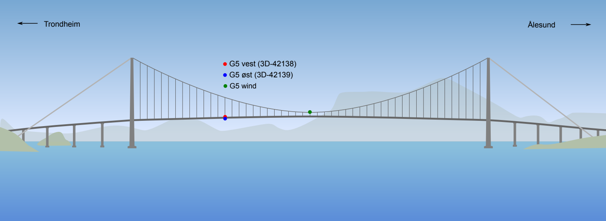
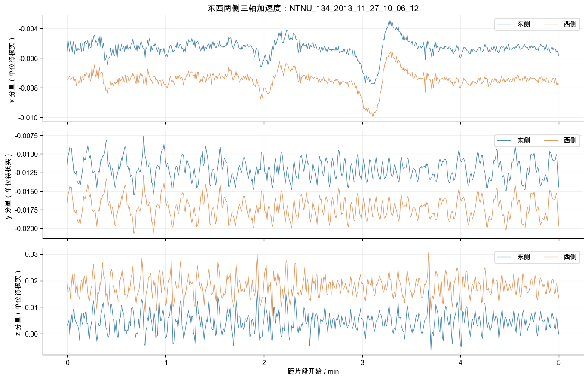
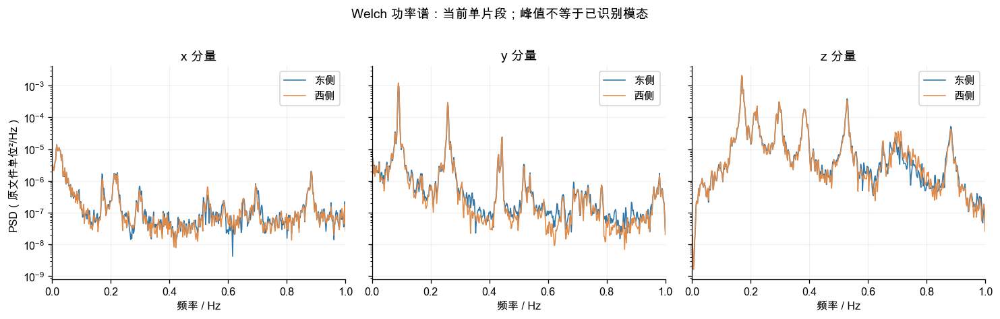

# PULSE 在 Gje 大桥数据集上的使用与 HMSFormer 对比计划

> 来源：本地 Gjemnessund 探索 notebook、H5 文件、HMSFormer 训练与数据源码、PULSE 论文及代码。具体入口见第 1 节。
> 状态：原入口的 Gje 接入已实现；全量数据预处理与 CPU 少量 batch 的训练、保存、重载、测试通过；正式 GPU 训练与 HMSFormer 对比尚未进行。
> 更新时间：2026-10-22
> 关联：[论文与架构笔记](PULSE-论文模型架构与创新点学习笔记.md) · [组合其他模型的方法](PULSE-组合到其他预测模型的通用方法.md)

## 0. 本阶段目标与默认决定

**先保持 PULSE 默认 MLP 架构，新增 Gje 数据适配；以 HMSFormer 的现有 Gje 设置为对齐依据，修正共同的数据问题后重跑两者。**HMSFormer＋PULSE 是后续组合实验，不与第一轮原版 PULSE 对比混为一谈。

| 项目 | 本计划的默认决定 |
| --- | --- |
| 首轮任务 | 与当前 HMSFormer 对齐：10 通道历史输入，预测相同 10 通道 |
| 窗口 | `T=720`，先 `H=96`，跑通后扩展到 `192,336,720` |
| 采样与片段 | 原 2 Hz，不降采样；每个窗口完全位于一个记录内 |
| 首轮数据协议 | 每记录 50% / 25% / 25%，统一样本清单；scaler 只拟合训练行 |
| 更强泛化检验 | 按记录时间分组切分，训练与测试不共享同一记录；作为独立协议 |
| 模型主对比 | 原版 PULSE、HMSFormer 从头训练、HMSFormer 预训练后微调，分别标明预算 |
| 辅助任务 | 仅六个加速度通道，两个模型都重新训练；后续再研究风条件输入 |
| 物理约束 | 本阶段不加入显式力学损失；单位、坐标、荷载映射仍待核实 |

PULSE 的“直接使用”是指保留模型方法并适配数据。当前已新增 Gje loader，原入口仍为 `run.py`，Linux 使用方法见第 9 节。

## 1. 已读取的来源与事实边界

| 来源 | 路径 / 内容 | 本次如何使用 |
| --- | --- | --- |
| 探索 notebook | [gjemnessund_dataset_exploration.ipynb](/Users/cyt/projects/i/bridge/PatchTST_self_supervised/tmp/gjemnessund_dataset_exploration.ipynb) | 阅读全部代码、保存的文字输出与相关图；重点为单元格 5、9、15、17、23、26、27，按 0 起始编号 |
| 原数据 | `/Users/cyt/projects/i/bridge/PatchTST_self_supervised/data/datasets/public/BRIDGE/gjemnessund.h5` | 本次只读复核全部 key 的长度与首记录数值、日期；未重扫全部数值质量 |
| HMSFormer 数据入口 | [datautils.py](/Users/cyt/projects/i/bridge/PatchTST_self_supervised/datautils.py)，`gjemnessund` 分支 | 确认 dataset、数据路径和窗口传入方式 |
| HMSFormer Dataset | [pred_dataset.py](/Users/cyt/projects/i/bridge/PatchTST_self_supervised/src/data/pred_dataset.py)，`Dataset_gjemnessund` 第 506 行起 | 切分、标准化、stride、返回值 |
| HMSFormer Gje 主脚本 | [HMSFormerLF.sh](/Users/cyt/projects/i/bridge/PatchTST_self_supervised/scripts/gjemnessund/finetune/HMSFormerLF.sh)、[预训练脚本](/Users/cyt/projects/i/bridge/PatchTST_self_supervised/scripts/gjemnessund/pretrain/HMSFormer.sh) | 窗口、patch、批大小与预训练流程 |
| HMSFormer 模型 / 训练 | [HMSFomer.py](/Users/cyt/projects/i/bridge/PatchTST_self_supervised/src/models/HMSFomer.py)、[patchtst_finetune.py](/Users/cyt/projects/i/bridge/PatchTST_self_supervised/patchtst_finetune.py)、[learner.py](/Users/cyt/projects/i/bridge/PatchTST_self_supervised/src/learner.py) | core 形状、RevIN、MSE、实际训练轮数 |
| PULSE | [models/PULSE.py](../models/PULSE.py)、[exp_main.py](../exp/exp_main.py)、[data_factory.py](../data_provider/data_factory.py) | 保留方法，列出新增适配点 |

Notebook 的 SHA-256 为 `a0f96601bf53a960eec49154c64ae7bc5649cb930159a079842363be4b0506e6`。PULSE 代码 commit 为 `b26449764b72bfc6aa0d5b961d702f0b59da3848`。

HMSFormer 工作目录有未提交修改，本次依据的是**当前本地文件**，不能只凭 Git HEAD 还原实验。正式运行应保存相关源码 diff 或文件哈希。Notebook 引用的外部监测资料在本次未重新联网核验，不将其补充信息当作已恢复的本地元数据。

### 1.1 本地数据已经确认什么

| 项目 | 已有依据 |
| --- | --- |
| 格式 | pandas fixed 结构 H5；每个顶层 key 是一个记录，不是普通 CSV |
| 规模 | 1,856 个记录，5,292,420 行，10 个数值通道 |
| 记录长度 | 1,443×3,620 点；411×141 点；1×7,188 点；1×3,621 点 |
| 时间 | Notebook 全部日期扫描显示片段内间隔 0.5 s，即 2 Hz；本次独立复核首记录一致 |
| 覆盖范围 | Notebook 保存输出为 2013-11-27 至 2018-10-23；不表示中间连续采样 |
| 首记录 | `NTNU_134_2013_11_27_10_06_12`，3,620×10，首记录数值有限 |
| 通道 | 东西两侧各三轴加速度，共 6；风传感器输出 `T/U/angle/w`，共 4 |
| 尚未完成 | 全量数值质量审计；完整单位、轴向、校准、重打包和降采样链条 |

列名是：

```text
accelerationG5 eastx
accelerationG5 easty
accelerationG5 eastz
accelerationG5 westx
accelerationG5 westy
accelerationG5 westz
windG5 windT
windG5 windU
windG5 windangle
windG5 windw
```

加速度不是位移，风通道也不是已知广义荷载。不能直接套用 $M\ddot u+C\dot u+Ku=f$ 并声称现有十列已满足状态与激励观测要求。



图源：Notebook 已保存的 `tmp/assets/sensor-layout-1.png`，复制到本笔记目录便于阅读；上游来源为 Notebook 记录的 NTNU / Zenodo 布置图。它提供测点关系，不能直接确认本地 x/y/z 结构轴向与单位。

### 1.2 对 PULSE 假设的实际提醒





图源：Notebook 单元格 18、23 的已保存图片，原样提取，示例均来自同一首记录。波形和功率谱显示多个时间尺度，但**单段谱峰不等于已识别的模态，也不能据此固定全数据周期**。2 Hz 采样仅能讨论保留在 1 Hz 奈奎斯特频带内的成分。

这意味着 PULSE 在 Gje 上是否适合，仍是实验问题。不要先假定存在 ETT 那样稳定的日周期，也不要把 0.17 Hz 等示例谱峰自动写成物理参数。

## 2. 先把 HMSFormer 的实际协议拆开

### 2.1 已核实的参数与模型输入

| 项目 | 当前 HMSFormer Gje 主脚本 / 源码 | PULSE 对齐方式 |
| --- | --- | --- |
| 历史长度 | `context_points=720` | `seq_len=720` |
| 预测长度 | `target_points=96,192,336,720` | 同一组 `pred_len` |
| 变量 | 默认 `features=M`，全部 10 个数值列 | `enc_in=10`，同顺序预测全部变量 |
| 样本滑窗步长 | `Dataset_gjemnessund.stride=16` | 新 loader 也为 16，不能用默认 stride=1 |
| 数据切分 | 每个记录前 50% 训练、中间约 25% 验证、后 25% 测试 | 共享完全一致的边界和窗口 manifest |
| 输入 patch | `patch_len=36,stride=36`，多尺度 `[36,12,6]` | 是 HMSFormer 的模型设置；PULSE Router 单独用 24 |
| 模型宽度 / 头数 | HMSFormer `d_model=16,n_heads=4` | PULSE Router `d_model=16,heads=1`；其 MLP 隐藏宽度仍为 512 |
| batch | 主脚本为 16 | 首轮也用 16，实测显存后再决定 |
| RevIN | `RevInCB(...,denorm=True)`，在 core 外执行 | PULSE 使用自身残差 norm / denorm |
| 时间信息 | Dataset 构造过，但 `__getitem__` 只返回 `(x,y)` | PULSE 另需历史 / 未来时间特征和 cycle index，须明确声明差异 |
| 预测损失 | 时域 MSE | PULSE 默认 FFT-MAE；增加同损失对照以解释差异 |

这些 patch 参数不要求在两个模型之间强制相等。公平性要求相同真实历史窗口和预测目标；内部 token 化是模型设计的一部分。

**脚本陷阱：**同目录的 `HMSFormerLF2.sh` 实际设置 `--dset_finetune metrla`，使用 48/16/4 的 patch 配置。本计划不把它当成 Gje 主配置，不能只根据目录名复制。

### 2.2 训练预算不能只看“微调 10 轮”

主预训练脚本设 100 epochs、mask ratio 0.5。微调脚本设 `n_epochs_finetune=10`，但实际调用：

```python
learn.fine_tune(n_epochs=args.n_epochs_finetune,
                base_lr=lr, freeze_epochs=20)
```

`Learner.fine_tune()` 先训练 head 20 轮，再解冻训练 10 轮。因此该配置的预算是 **100 轮预训练＋20 轮冻结阶段＋10 轮全模型微调**，还包括学习率查找。实际 LR 来自 `find_lr()`，不能只记录默认 `--lr`。

PULSE 原脚本的 30 轮监督训练，不能直接称为与这套流程“同训练成本”。最终表格必须单列预训练开销、微调开销、总时间与实际优化步数。

## 3. 对齐数据：建立一次、供两边共同读取

### 3.1 必须共同修正的标准化问题

HMSFormer 当前 `Dataset_gjemnessund.__read_data__()` 将完整 `df_data` 放入 `train_data_all` 后拟合 scaler，没有先截取每记录的训练部分。这使 scaler 使用了验证和测试数据统计量。

正式对比应改为：

```text
读取记录元信息与时间边界
 → 确定训练 / 验证 / 测试目标区间
 → 只用训练行拟合一份 scaler
 → 保存 scaler 与训练行清单
 → 两个模型加载同一份 scaler
 → 分别在同一标准化数据上应用各自模型的归一化
```

不能只修 PULSE、保留 HMSFormer 的泄漏 scaler，然后把新结果与旧日志比较。原版旧协议可以作为历史核对记录单独保留，但不作为修正后主结论。

拟合应按训练原始行计算统计量，避免先生成大量重叠窗口后重复加权拟合。验证/测试阶段不更新 scaler，也不对每个测试记录单独重新拟合它。

### 3.2 协议 A：先对齐现有片段内预测任务

对长度为 $n$ 的每个记录：

$$
a=\lfloor0.5n\rfloor,\quad c=\lfloor0.25n\rfloor,\quad b=n-c.
$$

目标分区为 train `[0,a)`、val `[a,b)`、test `[b,n)`。输入和目标用半开区间 `[s,s+T)`、`[s+T,s+T+H)`。

| 分区 | 目标必须位于 | 第一个窗口输入起点 |
| --- | --- | --- |
| train | `[0,a)` | 0 |
| val | `[a,b)` | `a-T` |
| test | `[b,n)` | `b-T` |

每个分区从相应起点按 16 递增，仅保留完整输入、完整目标且不越分区目标边界的窗口。验证 / 测试输入可以包含之前已观测到的上下文；目标不能跨分区，也不能跨记录。

如果起点为负，不使用 Python 负切片“自动处理”，而是明确跳过无法提供合法上下文的样本并记录原因。当前 411 个 141 点短记录，在 `T=720` 下不能生成合法窗口；不能用零填充把它们混进首轮实验。

Notebook 按现有计数方式得到下列数量。合法新 loader 在相同记录、stride 和边界下应复核一致；质量过滤后若减少，要保存过滤原因：

| H | 训练窗口 | 验证窗口 | 测试窗口 | 各分区可产窗记录 |
| --- | ---: | ---: | ---: | ---: |
| 96 | 91,146 | 73,751 | 73,751 | 1,445 |
| 192 | 82,476 | 65,081 | 65,081 | 1,445 |
| 336 | 69,471 | 52,076 | 52,076 | 1,445 |
| 720 | 34,791 | 17,396 | 17,396 | 1,445 |

此协议回答“同一记录中，已观测历史能否预测后续片段”。由于不同年份的每个记录都含训练前缀，它**不能被描述为严格的跨年份未来泛化实验**。

### 3.3 协议 B：独立记录的时间泛化

正式研究再增加按时间排序的记录 / 连续采集块分组切分，例如约 70% / 10% / 20%，具体日期边界由记录清单确定并固定。

先根据真实时间检查相邻记录是否连续或重叠，把不能独立划分的采集块分为同一组，再划分组，避免同一段物理数据落到不同集合。已知为不同事件时可按事件分组；没有事件标签时，不虚构事件 ID。

每个窗口仍只使用一条记录。此协议中 scaler、周期筛选、模型选择和自监督预训练都只使用训练组；验证用来选参数，测试保持封存。协议 A 与 B 分表报告，不用一个协议的 checkpoint 或分数填入另一个协议。

### 3.4 公共 manifest 是公平对比的依据

推荐为每个 horizon 保存共同的窗口清单：

```text
protocol_id, split, record_id, start_row, input_end_row,
target_start_row, target_end_row, input_start_time, target_end_time,
channel_schema_id, scaler_id, quality_filter_version
```

两个模型共享相同 `record_id,start_row,target_start_row,target_end_row`，只允许各自做内部模型变换。train 可以 shuffle，验证和测试固定顺序、不丢尾批；评估按样本数加权，不能对大小不同的 batch 均值再简单平均。

还要抽查各记录真实时间区间是否重叠。`record_id` 不同不自动保证物理数据独立；任何跨集合重复时间或重叠记录需在 manifest 阶段解决。

## 4. 任务、通道和指标先定清楚

### 4.1 主对齐任务 GJE-M10

```text
输入：过去 720 点 × 10 个通道
输出：未来 H 点 × 同 10 个通道
额外已知信息：PULSE 所需的时间特征与周期定位
禁止输入：未来真实加速度、未来实测风通道
```

这最接近当前 HMSFormer `features=M` 的任务。风信号在这里也是预测目标，不把它们当作已经知道的未来激励。

由于 `windangle` 的定义、参考方向和单位尚未完全核实，首轮为兼容原任务保留原数值，但必须单列说明：**原始 angle 的欧氏误差和线性 Mixup 有圆周边界局限，不能据此声称风向预测具有物理意义。**

主表同时报告：

- 十通道标准化 MSE / MAE，用于当前任务对齐。
- 六个加速度通道的平均 MSE / MAE，作为桥梁响应预测的重点结果。
- 风通道分项误差与每通道误差，避免整体均值掩盖响应误差。

### 4.2 独立辅助任务 GJE-A6

只输入并预测六个加速度通道，两个模型都从相同数据重新训练。此时 `enc_in=6`；需要新的 schema、scaler 和 checkpoint，不能把 M10 模型直接当成 A6 模型。

这一任务可以减少风字段解释和角度 Mixup 的影响，但也删除了历史风信息，不能与 M10 分数混成同一个榜单。

后续若要“历史风＋加速度输入，只预测加速度”，应新增明确的外生输入任务。原版 PULSE 输出通道等于输入通道，可先预测全通道、仅在加速度索引上监督，或设计专门映射；两种方式都要记录清楚。

角度单位确认后可以研究 `sin/cos` 编码与圆周指标，但输入输出维数、SAM 和恢复方式都会受影响。那是单独的数据表示变体，所有基线都需同步变更后重跑。

### 4.3 指标与尺度

设有效样本数为 $N$，通道数为 $C$：

$$
\operatorname{MSE}_{micro}
=\frac{1}{NHC}\sum_{i,h,c}(\widehat y_{i,h,c}-y_{i,h,c})^2.
$$

需要明确评估使用：**模型自身 RevIN / PULSE 逆变换之后、公共 StandardScaler 尚未逆变换的标准化坐标**。这是对齐模型预测的公共尺度；不要把残差归一化空间的数值拿来比较。

补充每记录误差再平均的 macro 指标，防止长记录或重叠窗口主导；物理单位核实前，scaler 逆变换的误差称“原文件数值尺度误差”，不写成 m/s²。

同时报告参数量、训练与推理时间、峰值 GPU 显存，采用同一硬件、batch、warmup 和计时方式。加速度经常接近零，首轮不以 MAPE 为核心指标。PSD / 频带误差只能作描述性补充，不能替代时域预测指标或证明已识别模态。

## 5. PULSE 在 Gje 上要适配哪些地方

### 5.1 新增 Dataset_Gjemnessund，而不是拼接导出一个 CSV

建议仍在 PULSE 项目内维护适配代码：

```text
data_provider/data_loader_gjemnessund.py  # 读取 H5、训练 scaler、窗口索引与缓存
data_provider/data_factory.py        # 注册 Gjemnessund
utils/gje_timefeatures.py            # 显式支持 0.5 秒与分数秒
scripts/Gjemnessund.sh               # 数据配置与四个独立 horizon
tests/test_gjemnessund.py            # 切分、标准化、边界、旧分支与原模型接口检查
```

上述接入文件已创建 / 修改；不单独建立新训练入口或训练循环。缓存默认放在 `all_datasets/.gje_cache/`，仅生成数值副本和协议制品，原 H5 保持只读。

H5 读取可参考 Notebook 的 `h5py` 读取器，分别还原数值块和日期块，严格核对日期行数与列顺序。不必为了复用旧代码一次性把全量数据读入三个 Dataset；建议训练统计流式计算，记录数值按需读取 / 缓存，初始 `num_workers=0`，再测吞吐。不要在 worker 间共享不安全的 H5 句柄。

目标返回协议与 PULSE 一致：

```text
x:           float32 [720,10]
y:           float32 [H,10]
x_mark:      float32 [720,F]
y_mark:      float32 [H,F]
cycle_index: int64   scalar
```

`record_id` 与窗口索引另保留在 manifest，评估时可以映射回去。原 HMSFormer Dataset 只返回 `(x,y)`，不能原封不动塞入当前 PULSE 实验循环。

### 5.2 时间特征：使用实际时间，明确其额外信息

推荐首轮采用三组 `sin/cos`：一天、一周、一年，共 `F=6`，日内相位包含分数秒；年长度按对应年份处理闰年。原始时间没有时区，本阶段只使用文件记录的时间，不自行转换为当地时间或 UTC。

所有特征只依赖已知日历。**不把未来风速、未来统计量或由未来目标识别的相位编码进 `y_mark`。**

PULSE 现有 `utils/timefeatures.py` 对秒级特征主要使用整数秒，且没有直接处理 500 ms offset 的完整分支。不能假定传 `--freq 500ms` 就会自动正确处理 2 Hz；需要显式的 Gje 时间编码器输入适配。

HMSFormer 当前没有实际接收日历特征。主对比应如实标注这一方法差异，再增加 PULSE 无时间编码的消融（将两侧 time encoding 贡献置零）或 HMSFormer 的显式时间条件变体，避免把收益全部归因于 Backbone。日历相位不等同于结构振动相位。

### 5.3 周期与码本：先给技术起点，再用训练数据验证

Gje 没有已经确认的统一周期 $W$。首个接口 / 小样本运行可以用 `cycle_len=96, inv_len=96` 作为**技术起点**，对应 48 秒参考分辨率，不能称为桥梁固有周期。

正式设置应在训练记录内部计算去均值后的 ACF / PSD，汇总不同通道和记录中的候选周期，在验证集比较少量候选；若无稳定周期，报告这一事实并做弱化码本的对照，而不是强行找一个物理解释。不得先拼接记录再计算 ACF。

周期索引基于真实时间 tick：

$$
q(t)=\frac{t-t_{ref}}{0.5\,s},\qquad
p=q(t_{\mathrm{target\ start}})\bmod W.
$$

固定 $t_{ref}$，先检查每个时间戳与 0.5 s 网格对齐；在原版 `cycle_index[s_end]` 约定下使用第一步目标时刻。中间有采集间隔时，tick 随真实时间跳过，不能用删除间隔后的全局行号假装连续。

`--gje_cycle_len` 是当前 CLI 中已实现的 loader 参数。`W=1` 也不等于完全去掉锚点：只要 `inv_len>1`，原公式仍会随历史偏移取不同码本项。真正去锚点的消融应明确让锚点分支贡献为零并保持 norm/denorm 一致。

### 5.4 推荐起跑配置与物理时长

| 参数 | 首轮建议 | 含义 / 边界 |
| --- | --- | --- |
| `seq_len` | 720 | 约 6 分钟历史，首末点实际跨度 359.5 s |
| `pred_len` | 96，之后 192/336/720 | 约 48/96/168/360 秒，不能照 ETT 解释为小时 |
| `enc_in` | 10 | GJE-M10；A6 辅助任务单独改为 6 |
| `label_len` | 0 | 与 PULSE 默认路径一致 |
| `window_stride` | 16 | 样本步长 8 秒，区别于模型 patch stride |
| Router `patch_size` | 24 | 同时整除 720 与四个 H；24 点相当于 12 秒 |
| `d_model` | 16 | Router 宽度；MLP 隐藏层 512 |
| `inv_len / cycle_len` | 96 / 96 | 首轮技术配置，正式值待训练/验证筛选 |
| `time_dim` | 6 | 上述自定义日历编码，属于本计划适配选择 |
| `dsa / dsb / ksize` | 1 / 1 / 5 | C=10 或 6 时避免下采样到零维 |
| `batch_size / num_workers` | 16 / 0 起步 | 按实际吞吐与显存决定，不承诺固定耗时 |
| `AMP` | 首轮关闭 | 当前原版 AMP 路径与默认训练目标不一致 |
| `rec_lambda / auxi_lambda` | 0 / 1 | 原版 FFT-MAE；MSE 对照另外运行 |
| seed | 先 2024；正式至少 3 个预先固定种子 | 对两个模型使用相同种子列表 |

你现有 A5000 / 3090 24 GB 可以作为首轮单卡环境；具体可用 batch 和耗时以这组长窗口的实测为准，不由 ETT 的表格推断。没有必要先为计划租用 4090。

### 5.5 长窗口与原版训练器需要检查的地方

PULSE 的 TimeEncoder 在当前实现用 `Conv1d(T,T,k)`，`T=720` 比默认 96 的参数开销更高；不能按短窗口的小参数量估计 Gje 模型。当前单窗口接口测试 `C=10,F=6,T=720,H=96` 的原版模型参数为 **3,062,364**。

完整训练前还要处理 / 核验：NumPy 2 与 `np.Inf`、按 GPU 写死的 checkpoint 加载、非 PULSE 分支未初始化的 `mixup_params`、学习率构造与衰减、AMP 目标不一致。建议将数据适配、必要兼容修正、方法变体分别记录，不能静默改完后仍称所有设置与原仓库完全相同。

## 6. 与 HMSFormer 怎么比较才有解释力

### 6.1 实验矩阵分三层

| 层次 | 模型 / 对照 | 回答的问题 |
| --- | --- | --- |
| 基础 sanity | Last-value、历史均值、两层 MLP，必要时 DLinear | 信号是否可预测，强偏置或低频成分是否主导误差 |
| 相同监督预算 | HMSFormer 从头训练；PULSE 原版从头训练 | 在相同训练数据、调参次数与监督预算下，两种方法表现如何 |
| 各自原生流程 | HMSFormer 100＋20＋10；PULSE 默认监督流程 | 两套实用训练方案的精度—总成本差异 |
| 方法分析 | PULSE-MSE；HMSFormer-FFT；PULSE 无 SAM / 无时间编码等 | 收益来自结构、损失、时间信息还是增强 |
| 后续组合 | HMSFormer＋PULSE，从头训练后再研究预训练迁移 | 框架能否改善该 Backbone |

不要为“公平”强制两个模型内部宽度、patch、注意力头数完全相同。公共部分是数据、输入信息边界、候选调参数量和评估规则；模型结构与合适学习率可以不同，但要给出同等验证选择机会。

### 6.2 预算控制与模型选择

首轮 `H=96` 做单种子功能试验；正式四个 horizon、多种子。相同监督预算组可先统一最多 30 epochs、相同 batch 和验证选优，并记录实际优化步数与最优 epoch；主比较再分列固定更新步数或固定计算预算结果，避免把“轮数相同”直接等同于计算成本相同。

HMSFormer 预训练组需要在**相同修正协议的训练行 / 训练记录**上重新预训练。如果旧 checkpoint 曾使用完整 H5 或全数据 scaler，不能直接作为干净协议下的预训练权重。没有预训练数据范围证据时，标为历史 checkpoint 参考结果。

所有学习率和超参数只看训练 / 验证集。测试集不逐 epoch 参与手工选模型；PULSE 原训练器会每 epoch 计算 test loss，正式实验应避免用这些输出调参，最好改成只在最终评估测试集。

### 6.3 统一结果表模板

| 协议 / 任务 | 模型 | H | 训练方式 | 损失 | 日历输入 | MSE-10 | MAE-10 | MSE-Acc6 | MAE-Acc6 | 总训练时间 | 参数 / 峰值显存 |
| --- | --- | ---: | --- | --- | --- | --- | --- | --- | --- | --- | --- |
| A / M10 | HMSFormer | 96 | 从头监督 | MSE | 无 | 待运行 | 待运行 | 待运行 | 待运行 | 待测 | 待测 |
| A / M10 | PULSE | 96 | 从头监督 | FFT-MAE | 有 | 待运行 | 待运行 | 待运行 | 待运行 | 待测 | 待测 |
| A / M10 | HMSFormer | 96 | 预训练＋微调 | MSE | 无 | 待运行 | 待运行 | 待运行 | 待运行 | 待测 | 待测 |

正式填多种子均值 ± 标准差，并按 H、通道组分别报告。高度重叠的窗口不是独立重复；若做区间估计或 bootstrap，按记录 / 采集组重采样，不把每个窗口当独立样本。当前状态不能填写任何优于 HMSFormer 的结论。

## 7. 分阶段实施与验收

| 阶段 | 工作 | 验收 | 状态 |
| --- | --- | --- | --- |
| P0 | 固定数据 schema、A 协议、源码哈希、训练范围 | 一份配置与变更清单 | 已有方案，待固化制品 |
| P1 | 数据质量扫描、manifest、训练集 scaler | 窗口计数、分区边界、重叠前缀处理 | 已实现并全量检查 |
| P2 | 两模型 DataLoader 对齐 | 相同窗口得到一致数值、通道顺序、y 和标准化统计 | 待实现 |
| P3 | PULSE 新 loader、时间/周期输入、训练器必要修正 | 原模型 train/eval 与 backward；旧分支回归 | 已实现，CPU 冒烟通过 |
| P4 | 小规模过拟合试验 | 固定训练窗口 loss 能明显下降，独立 eval 有限且反变换正确 | 待运行 |
| P5 | H=96 两模型单种子 | 同一 manifest 和 scaler、可复核日志与预测文件 | 待运行 |
| P6 | 四 horizon、多种子、损失/增强/时间信息分析 | 完整表格、失败配置与预算记录 | 待运行 |
| P7 | B 协议、A6 与 HMSFormer＋PULSE | 分别回答泛化、响应任务与组合收益 | 后续，待运行 |

### 7.1 两个 DataLoader 的关键一致性检查

- 同一 `record_id,start_row,H` 的输入和目标数组数值一致，通道顺序完全一致。
- 训练 scaler 的 fit 行清单只包含训练允许范围，两个项目读到的统计量相同。
- train/val/test 的目标索引不相交；不跨记录；重叠时间的记录得到一致处理。
- 所有窗口包含恰好 T / H 点；短记录过滤规则与样本总数有日志。
- 首尾 batch 都保留正确形状；验证与测试不丢尾批，评价按元素数聚合。
- PULSE 时间戳与数值一一对应，`y_mark` 不含未来观测值；改变目标值不改变推理输入。

### 7.2 本次实际完成的最小检查

本次读取首记录，使用其前 50% 行计算示例标准化统计，从中取 `720 → 96` 的真实窗口；构造仅来自时间戳的 6 维日历特征和技术用 `W=96` 索引，送入**未改动的原版 PULSE**：

```text
Python 3.10.20 / PyTorch 2.12.0 / CPU / random weights
x:       [1,720,10]
x_mark:  [1,720,6]
y_mark:  [1,96,6]
output:  [1,96,10]，全部有限
params:  3,062,364
```

这证明一组真实窗口可以满足原模型接口，不代表完成公共 loader、全训练集 scaler、模型训练或 HMSFormer 对比。该示例中的时间特征年分母按首记录 2013 年取 365；正式实现需覆盖闰年。

## 8. 原计划的实施范围与当前下一步

PULSE 侧已完成训练 scaler、窗口索引、原入口接入与短训练检查。当前下一步是在 Linux 执行 H=96 正式训练；HMSFormer 的 scaler 修正与两边 DataLoader 一致性检查仍待实施，旧日志暂不作为同协议对照。

这一阶段应交付：

1. 一份固定的 Gje-A-M10 数据协议和按 H 分开的窗口清单。
2. 一份仅由训练行拟合、两边共用的 scaler 与通道 schema。
3. 一个能返回 PULSE 所需五个输入项的 Dataset。
4. 一套保留 HMSFormer 模型行为的数据对齐入口。
5. 运行记录，包括源码版本、环境、seed、有效 LR、训练范围与评估尺度。

跑出结果后，再决定 PULSE 的周期假设、SAM 或未来锚点是否适合 Gje，并据此选择有证据支持的研究问题。


## 9. 已实现：Linux 直接使用

### 9.1 文件摆放与安装

```text
PULSE-phy/
├── run.py
├── all_datasets/
│   └── gjemnessund.h5
└── scripts/
    └── Gjemnessund.sh
```

从项目根目录，在已有可用 PyTorch 环境中安装补充依赖并运行：

```bash
python -m pip install -r requirements-gje.txt
bash scripts/Gjemnessund.sh
```

脚本仅运行 `720 → 96`、10 通道、batch 16、最多 30 epochs 的原版 PULSE；控制台和 `logs/Gjemnessund/Gjemnessund_720_96.log` 同时输出。下一次运行该脚本会覆盖同名文本日志，重要结果请先归档。其余 horizon 可在跑通后分别配置；尚未完成 Gje 超参数选优。

首次运行逐记录解析 H5、检查全部数值有限和 0.5 秒时间网格，仅用训练行拟合 scaler；数值缓存约 0.4 GiB，后续训练/验证/测试及其他 horizon 共用。缓存缺失会自动重建；不必从 macOS 复制缓存。读取使用 `h5py`，不需要 PyTables，日期块不执行 pickle 反序列化。

### 9.2 本次新增发现：相邻记录有重叠时间

全量检查发现 **380 条记录的前缀与之前记录重叠，共 382 行**。当前协议按时间先到者保留这些时刻，裁去后续记录重叠前缀，再按剩余长度做 50/25/25；没有整条记录被删除。

裁剪只发生在缓存副本，`gje_records.csv` 保存 `source_nrows` 和 `source_start_row`，可映射回 H5 原行号；窗口索引里的行号指裁剪后的记录。未来 HMSFormer 要使用相同的前缀处理与 scaler，不能只对齐窗口数量。

裁剪后本地全量窗口数仍与第 3 节表格一致，但部分起点和训练统计量已变化。训练 scaler 共拟合 **2,646,002** 行，包括短记录中属于训练区间的原始行；411 条短记录不产生当前 T=720 的训练/验证/测试窗口。

### 9.3 保留与新增的行为

- `models/PULSE.py`、原有数据类、原有 shell、优化器和非 AMP 的 SAM / FFT-MAE 计算保持不变。
- `run.py` 仅对 Gje 验证输入配置并增加实验配置摘要后缀，防止不同周期/步长/调试设置混用 checkpoint。
- Gje 验证/测试不 shuffle、不丢尾批；验证按元素数加权，最终测试用流式计算输出全通道、Acc6、风通道及逐记录 macro 指标。
- Gje 训练期间只使用验证集选 checkpoint，最终再测试；原数据集每 epoch 的 test 输出行为保留。
- Gje checkpoint 在 CPU / 当前设备上加载；`np.Inf → np.inf` 是等值兼容替换，没有改变早停规则。
- 初版 Gje 限定原版 PULSE、M10、calendar6、单设备、非 AMP；不新增 HMSFormer＋PULSE，不修改 HMSFormer 项目。
- 保留原训练器的 OneCycleLR 构造和 `type3` 行为，实测首 epoch LR 约 0.0002，不能把脚本中的 0.005 当作全程固定 LR。

### 9.4 输出与可复核制品

`checkpoints/<setting>/` 保存原格式 `checkpoint.pth`，以及：

```text
gje_run.json                 # 全参数、环境、模型 SHA、调试标记
gje_data_protocol.json       # 文件指纹、列序、记录边界、训练 scaler
gje_records.csv              # 原始长度、裁剪偏移、split 边界
gje_train_windows.npy        # [record_index, start_row]
gje_val_windows.npy
gje_test_windows.npy
gje_*_summary.json           # T/H、stride、cycle、跳过的短记录
```

`results/<setting>/gje_metrics.json` 保存指标和实际评估窗口数。指标位于公共 StandardScaler 坐标、PULSE 自身逆变换之后；没有宣称单位为 m/s²。原始 windangle 的欧氏误差局限仍存在。

仅测试时，保持训练参数一致，将 `--is_training 1` 改成 `--is_training 0`，入口会找到同一配置 checkpoint 并校验数据协议。当前未增加中断续训功能。

### 9.5 调试与验证记录

`--gje_record_limit 2 --gje_max_batches 2 --train_epochs 1 --batch_size 2` 可用于短流程检查；其余模型/数据参数保持脚本一致。这样的运行有独立配置后缀，并在 JSON 中写 `debug=true`，不能作为正式指标。

本次在 Python 3.10.20、PyTorch 2.12.0、CPU 上完成：

1. 全部 1,856 条记录的时间/数值检查、训练 scaler 与四个 horizon 的窗口计数。
2. 两条真实记录、T=720/H=96、两批训练/验证/测试；checkpoint 保存与单独测试重载，指标一致。
3. 合成数据测试：训练 scaler 不受未来数值改变影响、split 边界、短记录、重叠前缀、NaN/Inf 拒绝、闰年/半秒时间特征、原模型 backward、旧数据分派和验证尾批聚合。
4. Python 语法、shell 语法与原 CLI 检查。

运行自动检查：

```bash
python -m unittest discover -s tests -p 'test_gjemnessund.py' -v
```

这是接入与兼容性验证，尚未完成 Linux/CUDA 正式训练或论文精度复现。
